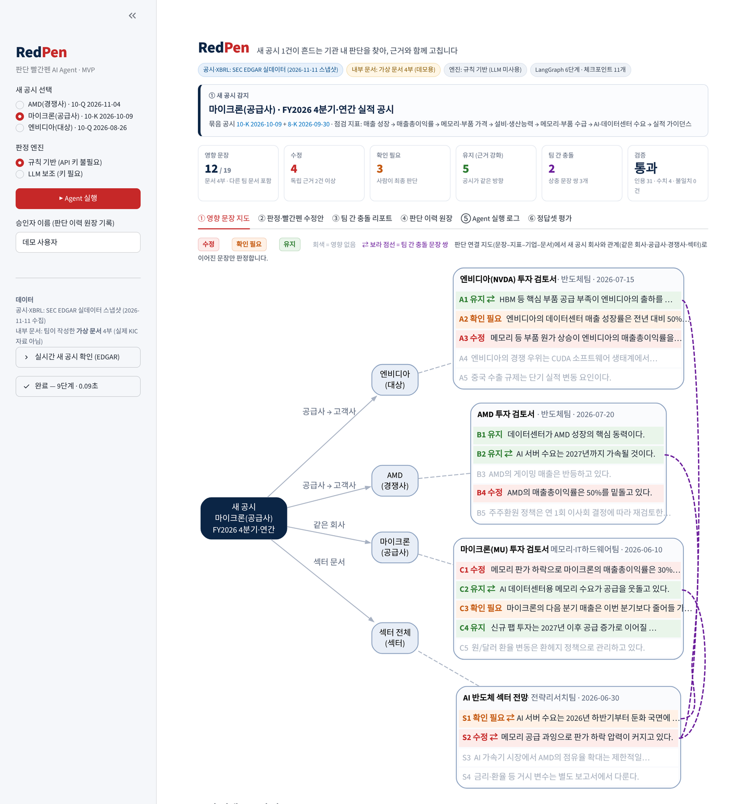

# RedPen (레드펜) — 판단 빨간펜 AI Agent · MVP

> 새 공시 1건이 흔드는 기관 내 판단을 찾아, 근거와 함께 고치는 AI Agent
> 「국부펀드 KIC, AI 에이전트 공모전」 팀 **MONDAI** (팀장 고상혁 · 팀원 노정환, 차형창)



새 실적 공시가 나오면 RedPen은 다음 순서로 움직입니다.

1. 그 공시가 기관 안 어느 문서의 어느 문장을 흔드는지 찾습니다. 다른 팀 문서도 경쟁사·공급사 관계를 따라 찾습니다.
2. 문장마다 공시 원문과 XBRL 원값으로 근거를 붙여 판정합니다. 판정은 **유지 · 수정 · 확인 필요 · 영향 없음** 중 하나입니다.
3. 팀 간에 서로 반대인 판단(**충돌**)을 드러냅니다.
4. 수정안은 변경 추적 Word 문서로 만듭니다. 판정·승인 이력은 원장에 남깁니다.

이 저장소는 예선 기획서의 6단계 Workflow를 실제로 동작하는 코드로 옮긴 MVP입니다.

---

## 빠른 실행

```bash
python -m venv .venv && source .venv/bin/activate      # Python 3.11 이상
pip install -r requirements.txt
streamlit run app.py                                    # http://localhost:8501
```

- API 키 없이 바로 실행됩니다. 기본 모드는 **규칙 기반 판정 + 코드 계산**입니다.
- 첫 화면에서 마이크론(공급사) 실적 공시 시나리오가 자동으로 실행됩니다.

테스트와 API(선택)는 다음과 같이 실행합니다.

```bash
pip install -r requirements-dev.txt
pytest -q                     # 19개 테스트: 정답셋 회귀, 재탐색·검증 루프, 원장 변조 탐지, 변경 추적 docx, EDGAR 파서, LLM 호출 상한
uvicorn api:app --port 8000   # GET /events · POST /runs/{event_id} · GET /ledger
```

---

## 데모 시나리오 (기획서 ⑥의 데모 시나리오 그대로)

| 단계 | 화면 | 내용 |
|---|---|---|
| 1 | 상단 배너 | **공급사의 새 분기 공시 감지**: 마이크론 FY2026 4분기·연간 실적 (10-K 2026-10-09 + 실적 보도자료 8-K 2026-09-30, 실제 EDGAR 공시) |
| 2 | ① 영향 문장 지도 | 내부 문서 4부, 19문장 가운데 **12문장**이 이 공시와 연결됨. 공급사 → 고객사 경로로 엔비디아·AMD 검토서까지 추적 |
| 3 | ③ 팀 간 충돌 리포트 | 'AI 서버 수요 가속(반도체팀)' vs '둔화(전략리서치팀)', '메모리 공급 부족' vs '공급 과잉'. 최신 공시 근거는 양쪽 모두 앞의 판단 쪽 |
| 4 | ① 문장 선택 → 근거 카드 | 공시 원문 위치(Item·소제목·단락), 인용문, XBRL 원값·계산식, SHA-256, SEC 원문 링크 |
| 5 | ② 수정안 승인 | 승인·반려가 ④ 판단 이력 원장(해시 체인)에 기록되고, 변경 추적 .docx로 내려받음 |

### 실제 실행 결과 (규칙 기반 모드)

| 새 공시 | 영향 문장 | 수정 | 확인 필요 | 유지 (근거 강화) | 충돌 쌍 | 재탐색 |
|---|---|---|---|---|---|---|
| 마이크론 10-K (공급사) | 12 / 19 | C1, A3, B4, S2 | A2, S1, C3 | C4, A1, C2, B1, B2 | A1↔S2, C2↔S2, B2↔S1 | 5문장 |
| AMD 10-Q (경쟁사) | 7 / 19 | B4 | B3, A4, S3, S1 | B1, B2 | B2↔S1 | 1문장 (3회) |
| 엔비디아 10-Q (대상) | 8 / 19 | A3, S2 | A2, S3, S1, A4 | B2, A1 | B2↔S1, A1↔S2 | 1문장 |

수정안 예시 (사실 전제만 고침, 숫자는 모두 XBRL 원값에서 코드로 계산):

- **C1** `메모리 판가 하락으로 마이크론의 매출총이익률은 30%대에 머물러 있다.`
  → `마이크론의 매출총이익률은 FY2026 4분기 86.8%로 전년 동기(44.7%) 대비 42.1%p 상승했다(FY2026 연간 80.7%).`
  - 근거 1: XBRL 계산값 (4분기 = 연간 − 3분기 누계)
  - 근거 2: 10-K 본문 "gross margin percentage improved to 81% for 2026 from 40% for 2025"
- **S2** `메모리 공급 과잉으로 판가 하락 압력이 커지고 있다.`
  → `AI 수요 증가가 업계 공급 증가를 앞지르며 메모리·부품 공급 제약이 이어지고 있다.`
  - 1차 탐색: 마이크론 공시만으로는 독립 근거 1건 → 2차 탐색에서 범위를 넓혀 엔비디아 10-Q "currently experiencing certain supply constraints" 추가 → 독립 근거 2건 → 수정

> **기획서 Summary 예시와 다른 점**: 기획서 2쪽의 가상 예시('공급사 출하 증가로 부품 공급 제약이 완화되고 있다'로 수정)는 실제 공시와 반대입니다.
> 실제 마이크론 10-K는 "AI-driven memory and storage demand growth is outpacing industry supply", 엔비디아 10-Q는 "currently experiencing certain supply constraints"라고 씁니다.
> 그래서 실데이터로 돌리면 A1('공급 부족이 출하를 제한')은 **유지(근거 강화)**, 섹터 전망의 S2('공급 과잉')가 **수정** 대상입니다.

---

## 6단계 Workflow와 코드 위치

LangGraph `StateGraph` 하나로 구현했습니다 (`redpen/workflow.py`). 노드 6개, 조건 분기 2개, `InMemorySaver` 체크포인트를 씁니다.

```
① Planner → ② Impact Mapper → ③ Retriever → ④ Calculator → ⑤ Judge ─┬─→ ⑥ Verifier·Writer ─┬─→ 종료
                                    ↑                                   │                       │
                                    └── 근거 부족: 검색어·범위 바꿔 재탐색 (최대 3회)  └── 검증 실패: 근거 제외 후 재판정
```

| 단계 | 하는 일 | 코드 |
|---|---|---|
| ① 공시 감지·계획 | 정기공시 + 직전 45일 실적 8-K를 한 이벤트로 묶고, 공시가 건드린 지표와 우선순위(XBRL 확정 지표 먼저)를 정함 | `store.events()`, `judgment_map.touched_topics()` |
| ② 영향 범위 탐색 | **판단 연결 지도**(문장–지표–기업–문서, NetworkX)에서 관계별 전파 규칙(같은 회사·공급사→고객사·고객사→공급사·경쟁사·섹터)으로 영향 문장 결정 | `judgment_map.py`, `topics.PROPAGATION` |
| ③ 근거 탐색 | 국문 주장 → 영문 검색어 → 문장 단위 BM25 → 방향 판별(대조 구문·가능성 표현 처리). 재탐색 때 1차 새 공시 → 2차 대상 회사 최신 공시(+동의어) → 3차 모니터링 기업 전체로 넓힘 | `retrieval.py` |
| ④ 수치 확인 | XBRL 원값으로 매출총이익률·전년 동기 대비·가이던스 대비 증감 계산. 4분기는 연간 − 3분기 누계로 만들고 계산식 기록. **LLM 계산 금지** | `xbrl.py`, `rules.calc_evidence()` |
| ⑤ 판정·충돌 검사 | 기획서 ③ 판정 기준표를 규칙으로 구현(아래 표), 같은 지표에 반대 방향인 문장 쌍 탐지 | `rules.py` |
| ⑥ 검증·기록 | 인용문이 원문 단락에 그대로 있는지, XBRL 원값을 다시 찾아 같은 수치가 나오는지, 수정안 숫자가 계산값과 같은지 재대조 → 변경 추적 docx, 해시 체인 원장 | `verify.py`, `outputs.py` |

### 판정 규칙 (기획서 ③ → `rules.judge_claim`)

| 규칙 | 판정 | 조건 |
|---|---|---|
| R0 | 영향 없음 | 판단 연결 지도에서 새 공시와 이어진 경로 없음 (판정하지 않음) |
| R2 | 유지 | 공시가 문장의 전제와 같은 방향 → 근거만 추가 (근거 강화) |
| R3 | 수정 | 사실 전제와 반대인 **서로 독립된 근거 2개 이상**. 독립 = 다른 공시이거나 같은 공시라도 XBRL 수치 vs 본문 서술. 경영진 전망 문장은 세지 않음 |
| R4a | 확인 필요 | 반대 근거가 1개뿐 → 재탐색, 3회 후에도 1개면 사람에게 넘김 |
| R4b | 확인 필요 | 전망 문장이거나 가이던스·경영진 발언(가설)이 근거 → 해석 여지 |
| R4c | 확인 필요 | 같은 방향·반대 방향 근거가 엇갈림 |
| R4d | 확인 필요 | 경쟁 구도처럼 해석이 필요한 지표 → 관련 근거만 정리해 전달 |
| R4e | 확인 필요 | 재탐색 3회 후에도 근거 없음 |
| R4v | 확인 필요 | 검증 2회 실패 (수치·출처 불일치) |
| 충돌 | 리포트 | 같은 (기업·지표) 또는 섹터 문장과 회사 문장이 반대 방향 → 최신 공시 근거 수와 함께 양쪽 팀에 전달 |

모든 근거에는 **사실 / 계산값 / 가설** 3단계 라벨이 붙습니다.

---

## 데이터

| 데이터 | 출처 | 내용 |
|---|---|---|
| 공시 목록 | SEC EDGAR Submissions API | NVIDIA·AMD·Micron 최근 10-Q·10-K·8-K (`data/snapshot/filings.json`) |
| 재무 수치 | SEC EDGAR XBRL companyfacts | 매출(Revenues / RevenueFromContract…)·GrossProfit·InventoryNet 원값 (`xbrl.json`) |
| 공시 본문 | EDGAR 원문 | Micron 10-K Item 7, NVIDIA·AMD 10-Q Item 2 MD&A 발췌, Micron 실적 보도자료(Ex.99.1)와 Business Outlook 표 (`sections/`) |
| 기업 관계 | 팀 검수 입력 | Micron → NVIDIA·AMD 공급, AMD ↔ NVIDIA 경쟁 (`data/companies.yaml`) |
| 내부 문서 | **팀이 작성한 가상 문서** | 기업 검토서 3부 + 섹터 전망 1부, 19문장 (`data/internal_docs/`). 실제 KIC 자료가 아님 |
| 정답셋 | 팀 작성 (초안) | 공시 2건 × 19문장 판정 + 충돌 쌍 (`data/gold.yaml`) |

- 스냅샷은 2026-11-11에 SEC 공개 API·원문을 조회해 저장한 **실제 데이터**입니다. 본문은 원문 문장을 그대로 옮긴 발췌입니다 (`data/snapshot/manifest.json`).
- 실시간 갱신은 다음과 같습니다.
  - `SEC_USER_AGENT="팀명 연락처"`를 설정하고 `python scripts/build_snapshot.py --out data/snapshot_live`를 실행합니다.
  - 실행 시 `REDPEN_SNAPSHOT=data/snapshot_live`를 지정합니다.
  - User-Agent 명시, 초당 8회 이하, 지수 백오프 재시도, 캐시로 SEC 공정 접근 정책을 지킵니다.
  - 앱 사이드바의 「실시간 새 공시 확인」은 스냅샷 이후의 새 실적 공시를 보여 줍니다.
  - 실시간 클라이언트는 테스트용 가짜 응답으로만 검증했습니다. 개발 환경에서 SEC 접속이 막혀 있었기 때문입니다.

## LLM 모드 (선택)

키를 설정하면 세 가지 단계에 LLM을 씁니다.

- 주장 추출 (경량 모델)
- 근거 문장 방향 분류 (경량 모델)
- 수정 문안 작성 (고성능 모델)

판정 규칙과 모든 수치는 그대로 코드가 담당합니다. LLM이 쓴 수정 문안에 계산값과 다른 숫자가 있으면 검증 단계가 반려합니다. 그다음 재판정에서 템플릿 문안으로 바꿉니다 (`tests/test_reliability.py`에서 확인).

```bash
export REDPEN_LLM_PROVIDER=anthropic        # anthropic | openai | openai_compatible(사내 모델)
export REDPEN_LLM_API_KEY=...               # 또는 ANTHROPIC_API_KEY / OPENAI_API_KEY
export REDPEN_LLM_MODEL=...                 # 판정·검증용 (기본: claude-sonnet-5-5 / gpt-4.1)
export REDPEN_LLM_MODEL_FAST=...            # 분해·분류용 (기본: claude-haiku-5-5 / gpt-4.1-mini)
export REDPEN_LLM_BASE_URL=...              # openai_compatible일 때 사내 엔드포인트
```

LLM 호출이 실패하거나 형식이 틀리면 해당 항목만 규칙 기반 결과로 되돌립니다.

## 평가 (⑥ 정답셋 평가 탭)

정답셋 초안 기준 결과는 다음과 같습니다.

- 마이크론·AMD 공시 2건: 영향 문장 탐지율 100%, 무영향 오탐률 0%, 판정 일치율 100%, 충돌 탐지 100%, 수치·출처 오류 0건
- 검증 단계 재대조: 마이크론 공시 기준 인용 31건, 수치 4건, 수정안 숫자 10건

> ⚠️ 이 수치는 **일반화 성능이 아닙니다**. 정답셋은 데모 문서를 쓴 팀원이 만든 1차 라벨이고, 판정 규칙도 같은 문서로 다듬었습니다. 이 결과는 '설계한 대로 동작한다'는 회귀 테스트입니다.
> 기획서대로 본선에서는 다음을 진행합니다.
> - 작성자와 다른 팀원이 다시 라벨링합니다.
> - 문서·공시를 늘립니다.
> - 같은 입력을 넣은 단일 LLM 프롬프트와 비교합니다.

## 폴더 구조

```
app.py                  Streamlit 데모 (6개 탭)
api.py                  FastAPI (선택)
redpen/
  workflow.py           LangGraph 6단계 그래프 · 재탐색/재판정 루프
  store.py              스냅샷 로딩 · 공시 이벤트 묶기 · 기업 관계
  claims.py             내부 문서 문장 분리 · 주장 추출(규칙 / LLM)
  topics.py             주장 유형 6종 · 세부 지표 사전 · 관계별 전파 규칙
  judgment_map.py       판단 연결 지도(NetworkX) · 영향 문장 지도(Graphviz)
  retrieval.py          문장 단위 BM25 · 근거 방향 판별 · 재탐색 범위
  xbrl.py               XBRL 원값 계산 (분기 · 4분기 파생 · 마진 · 증감률)
  rules.py              판정 규칙 · 수정 문안 · 충돌 검사
  verify.py             인용·수치·수정안 재대조
  outputs.py            변경 추적 docx · 판단 이력 원장(해시 체인)
  llm.py                LLM 어댑터 (Anthropic / OpenAI / 사내 OpenAI 호환)
  edgar.py              EDGAR 실시간 클라이언트 · 본문 파서
  eval.py               정답셋 평가
scripts/build_snapshot.py   EDGAR 스냅샷 재생성
data/                   스냅샷 · 가상 내부 문서 · 기업 관계 · 정답셋
tests/                  pytest 19개
```

## 배포 (Streamlit Community Cloud)

전체 절차(GitHub → 배포 → API 연동 → 본선 제출 점검)는 [`docs/DEPLOY_RUNBOOK.md`](docs/DEPLOY_RUNBOOK.md)에 있습니다. 요약은 다음과 같습니다.

1. Main file은 `app.py`, Python은 3.11 이상으로 지정합니다.
2. Secrets는 비워 두면 규칙 기반으로 동작합니다. LLM 모드는 [`.streamlit/secrets.toml.example`](.streamlit/secrets.toml.example) 형식대로 키를 넣으면 켜집니다.
   - 공개 데모에서는 `REDPEN_LLM_PASSCODE`(접근 코드)와 `REDPEN_LLM_MAX_CALLS`(호출 상한)로 API 비용을 보호합니다.
3. private 저장소에서 배포한 앱은 기본이 비공개입니다. 심사용으로는 Share → Make this app public으로 공개합니다.

## 한계와 본선 계획

- **검색**: 문장 단위 BM25 + 국문→영문 검색어 사전입니다. 본선에서 다국어 벡터 검색(Chroma)을 더해 하이브리드로 바꿉니다.
- **주장 추출**: 규칙 기반은 데모 문서 19문장에 맞춰져 있습니다. 새 문서는 LLM 모드를 쓰거나 사전을 늘려야 합니다.
- **기업 관계**: 수기 입력입니다. 본선에서 10-K의 경쟁사·고객·공급사 언급을 추출한 뒤 검수하도록 바꿉니다.
- **세그먼트 수치**: companyfacts API에는 세그먼트(차원) 값이 없습니다. 그래서 세그먼트 매출 주장은 본문 근거만 씁니다 (예: AMD 게이밍 B3 → 확인 필요).
- **평가**: 정답셋 재라벨링, 단일 LLM 대비 비교 실험, 검토·반영 시간 측정은 본선에서 진행합니다.

## 출처·이용 조건 · 생성형 AI 활용

- **SEC EDGAR 공개 데이터**: 인증·키가 필요 없습니다. SEC 공정 접근 정책을 따릅니다 (sec.gov/edgar/sec-api-documentation).
- **오픈소스**: LangGraph (MIT), Streamlit (Apache-2.0), NetworkX (BSD-3), rank_bm25 (Apache-2.0), python-docx (MIT), FastAPI (MIT), PyYAML (MIT), pandas (BSD-3).
- **생성형 AI**: 코드 초안 작성에 Claude (Anthropic)를 사용했습니다. 최종 코드는 팀이 검토·수정합니다. 본선 제출물에 사용 도구·버전을 명시합니다.
- **민감정보**: 개인정보·실제 내부 자료·API 키는 포함되어 있지 않습니다.
